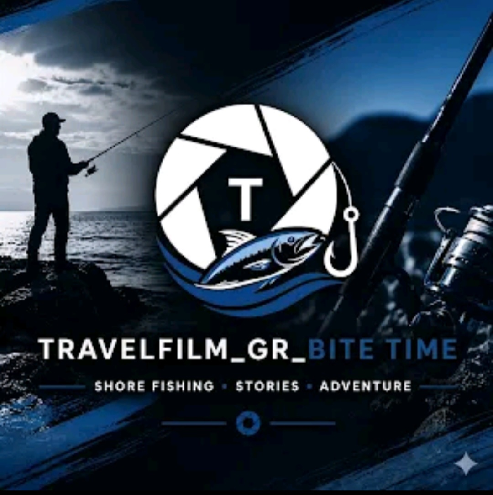

---
layout: default
title: Travelfilm_gr Bite time
permalink: /fishing/
---

  <!-- BITE TIME BRAND -->
  <section class="container fish-brand fade-in">

    

    <h1>Travelfilm_gr Bite time</h1>

    

      Fishing • Adventures • Moments
    

  </section>

  <!-- FIND FISHING ARTICLES -->

  

  

  

    

      
      

    

  

  <!-- FEATURED FISHING ARTICLE -->

  <section class="blog-hero fade-in">

    

      

      

      <a href="{{ featured.url | relative_url }}" class="featured-post">

        

          

        

        

          
            Featured Fishing
          

          <h1>{{ featured.title }}</h1>

          

            

              {{ featured.excerpt | strip_html | truncate: 160 }}
            

          

        

      </a>

    

  </section>

  <!-- INTRO -->

  <section class="container fade-in blog-intro">

    
      Bite time
    

    <h2
      data-en="Fishing Adventures"
      data-el="Ψαρευτικές Εξορμήσεις"
    >
      Fishing Adventures
    </h2>

    

      Fishing stories, outdoor adventures and moments captured by the water.
    

  </section>

  <!-- GALLERY BUTTON -->

  <section class="container fish-gallery-link fade-in">

    <a href="/fishing/gallery/">

      
        Explore Fishing Gallery
      

    </a>

  </section>

  <!-- SEARCH -->

  <section
    class="container fade-in"
    style="padding-top:0; padding-bottom:10px;"
  >

    

      <input
        type="text"
        class="search-input"
        data-blog-search
        data-placeholder-en="Search fishing adventures..."
        data-placeholder-el="Αναζήτηση ψαρευτικών εξορμήσεων..."
        placeholder="Search fishing adventures..."
        aria-label="Search fishing adventures"
      >

    

  </section>

  <!-- FILTERS -->

  <section class="container fade-in">

    

      <button
        onclick="filterPosts('all', event)"
        class="active"
        data-en="All"
        data-el="Όλα"
      >
        All
      </button>

      <button
        onclick="filterPosts('sea', event)"
        data-en="Sea"
        data-el="Θάλασσα"
      >
        Sea
      </button>

      <button
        onclick="filterPosts('shore', event)"
        data-en="Shore Fishing"
        data-el="Ακτή"
      >
        Shore Fishing
      </button>

      <button
        onclick="filterPosts('spinning', event)"
        data-en="Spinning"
        data-el="Spinning"
      >
        Spinning
      </button>

      <button
        onclick="filterPosts('freshwater', event)"
        data-en="Freshwater"
        data-el="Γλυκά Νερά"
      >
        Freshwater
      </button>

      <button
        onclick="filterPosts('other', event)"
        data-en="Other"
        data-el="Άλλα"
      >
        Other
      </button>

    

  </section>

  <!-- FISHING ARTICLES GRID -->

  <section class="container fade-in">

    

      

        

          

          

          

            <!-- PHOTO -->

            

              

            

            <!-- ARTICLE CONTENT -->

            

              <a
                href="{{ fishing.url | relative_url }}"
                class="blog-post-link"
                style="
                  text-decoration:none;
                  color:inherit;
                  display:block;
                "
              >

                

                  
                    {{ fishing.category | default: 'other' }}
                  

                  

                    
                      {{ fishing.date | date: "%d %b %Y" }}
                    

                  

                

                <h3>
                  {{ fishing.title }}
                </h3>

                

                  

                    {{ fishing.excerpt | strip_html | truncate: 130 }}
                  

                

              </a>

            

          

        

      

    

    

    

      
        
      

    

    

      

        New fishing adventures coming soon.
      

    

  </section>

